

  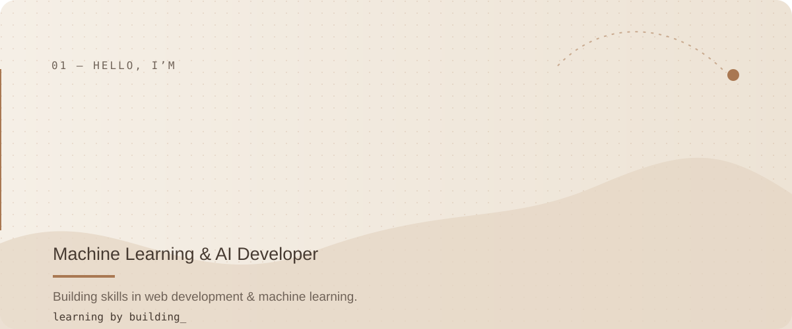

  <a href="#about">ABOUT</a>&nbsp;&nbsp;·&nbsp;&nbsp;
  <a href="#currently-building">NOW</a>&nbsp;&nbsp;·&nbsp;&nbsp;
  <a href="#selected-projects">PROJECTS</a>&nbsp;&nbsp;·&nbsp;&nbsp;
  <a href="#activity">ACTIVITY</a>&nbsp;&nbsp;·&nbsp;&nbsp;
  <a href="#let's-connect">CONTACT</a>

  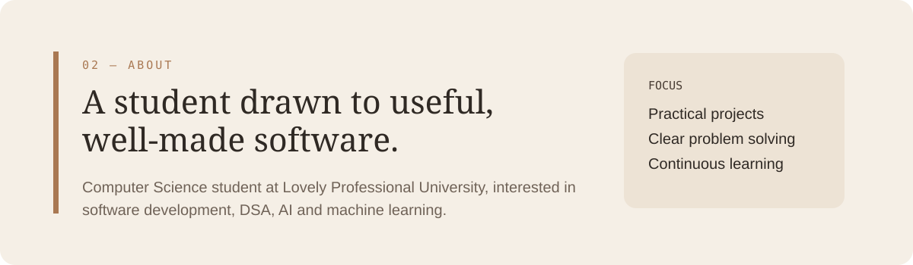

  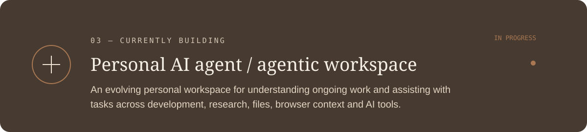

  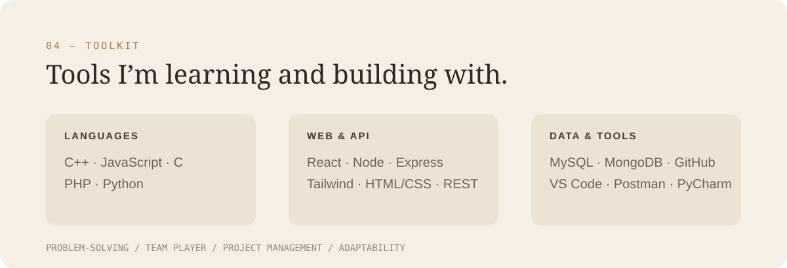

  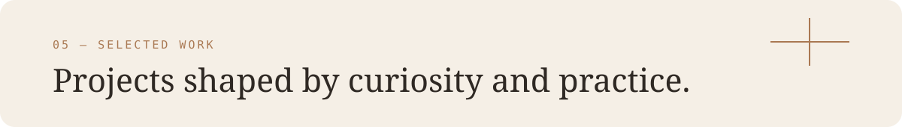

<table>
  <tr>
    <td width="50%"><a href="https://github.com/Umesh-KA121/Portfolio-Website">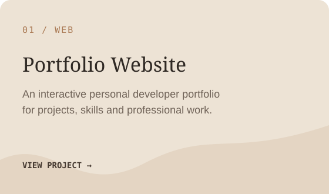</a></td>
    <td width="50%"><a href="https://github.com/Umesh-KA121/AI-Resume-Builder">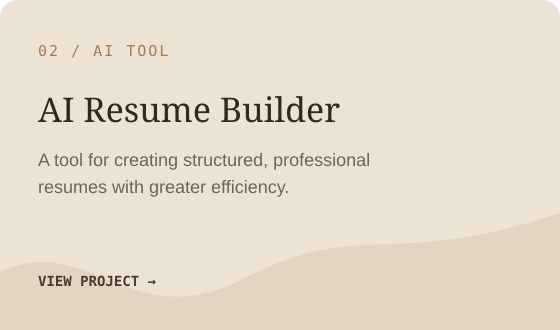</a></td>
  </tr>
  <tr>
    <td width="50%"><a href="https://github.com/Umesh-KA121/CollabFlow">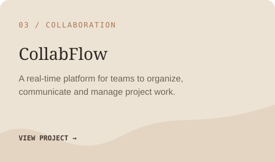</a></td>
    <td width="50%"><a href="https://github.com/Umesh-KA121/Customer_Behaviour_Analysis">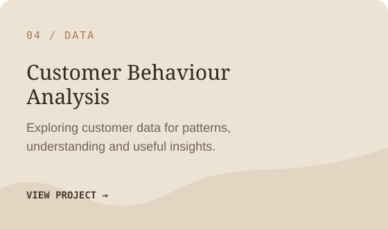</a></td>
  </tr>
  <tr>
    <td width="50%"><a href="https://github.com/Umesh-KA121/E-Commerce-Customer-Behaviour">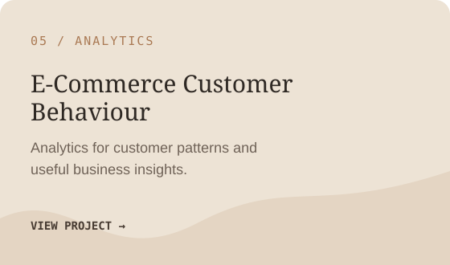</a></td>
    <td width="50%"><a href="https://github.com/Umesh-KA121/Emergency_Routing">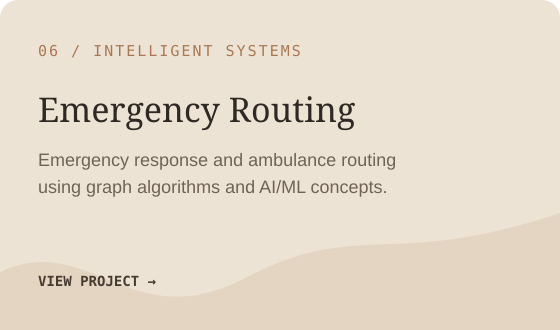</a></td>
  </tr>
</table>

  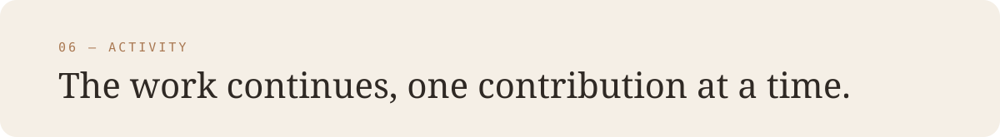

  
  

  

  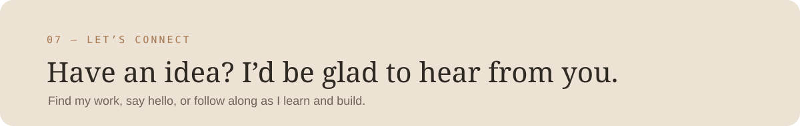

  &nbsp;
  &nbsp;
  &nbsp;
  &nbsp;
  

  

